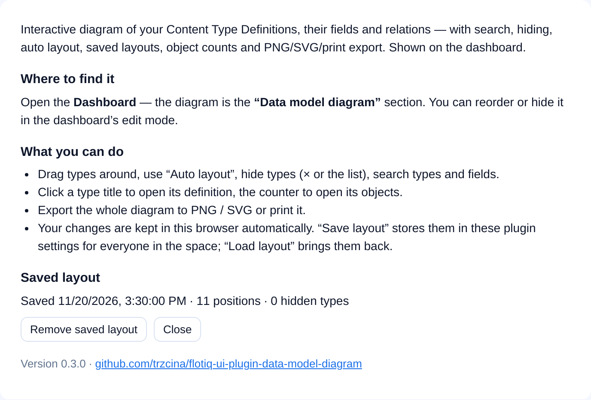

<a href="https://flotiq.com/">
    
</a>

# Data model diagram — Flotiq UI plugin

An interactive diagram of your Flotiq **Content Type Definitions**, their **fields** and **relations**, right on the
Flotiq dashboard.


## Features

- **Every content type as a card** with its fields: types, relation targets (`→ author`, `→ category[]` for multiple),
  `req` / `UK` / `T` badges (required, unique, title field). Nested list fields are shown indented.
- **Relations as edges**, drawn from the relation field to the target type. Hover a card to highlight its relations.
- **Object counts** per type. Click the count to open the objects, click the title to open the definition.
- **Layout:** drag cards, **Auto layout** (ELK), zoom / fit view, minimap, fullscreen.
- **Hide types** with the × on a card or with the list on the left. **Search** across type and field names.
- **Remember the layout:** your changes are kept in your browser automatically. **Save layout** stores positions and
  hidden types in the plugin settings for everyone in the space, **Load layout** brings them back, **Reset** shows all
  types and arranges them again.
- **Export** the whole diagram to PNG or SVG, or print it.
- Flotiq look and feel (editor design tokens and font), including **dark mode**.
- ⚙ in the toolbar opens Plugins, where **Manage** shows a description of the plugin and the saved layout:

  

## Installation

1. In Flotiq, go to **Plugins** and find the **Custom plugin** field.
2. Paste the manifest URL and add the plugin:

   ```
   https://trzcina.github.io/flotiq-ui-plugin-data-model-diagram/plugin-manifest.json
   ```

3. Open the **Dashboard**. The diagram is the **Data model diagram** section. You can reorder or hide it in the
   dashboard's edit mode.

### Permissions

| Permission                             | Why                                                                        |
| -------------------------------------- | -------------------------------------------------------------------------- |
| `CTD` `*` — read                       | Read the content type definitions.                                         |
| `CO` `*` — read                        | Object counts (`list({ limit: 1 })` → `total_count`). Shows `–` if denied. |
| `CO` `_plugin_settings` — read, update | **Save layout** (stored under `layout` in this plugin's settings).         |

Saving a layout needs a user who may edit plugin settings, and the plugin has to be installed in the space. A plugin
loaded temporarily with `FlotiqPlugins.loadPlugin` has no settings object to save to.

## Development

```bash
yarn          # install
yarn start    # watch mode, serves https://localhost:3053/index.js and /plugin-manifest.json
yarn build    # production bundle in dist/ (index.js + plugin-manifest.json)
yarn lint     # eslint (also runs as part of the build)
yarn format   # prettier
```

Accept the self-signed certificate by opening `https://localhost:3053/index.js` in the browser first. Then either:

- load it temporarily in the Flotiq editor console:
  `FlotiqPlugins.loadPlugin('flotiq.data-model-diagram', 'https://localhost:3053/index.js')`, or
- install it from `https://localhost:3053/plugin-manifest.json`. In watch mode the served manifest points at the
  local bundle.

### How it works

- Placement: `flotiq.dashboard.section::add`. The Flotiq plugin API has no menu or page hook. The settings screen
  uses `flotiq.plugins.manage::render`.
- Stack: React 19, [React Flow](https://reactflow.dev) (`@xyflow/react` 12), [ELK](https://eclipse.dev/elk/) for
  auto layout, `html-to-image` for export. esbuild bundles everything into a single `dist/index.js` with the CSS
  inlined, because Flotiq loads only the JS file.
- Styling: `plugins/styles/style.css` maps everything to the editor's CSS design tokens (`--color-*`), so light and
  dark mode follow the editor.

```
plugins/
  index.jsx                 registration, CSS injection, dashboard section, settings screen
  components/
    DiagramApp.jsx          state, layout, toolbar actions (toolbar is a declarative list of groups)
    EntityNode.jsx          content type card
    Sidebar.jsx             search + show/hide list
    Toolbar.jsx
    SettingsPanel.jsx       "Manage" modal content
  data-model/
    model.js                CTD JSON → entities, fields, relations
    api.js                  content types + object counts
    layout.js               ELK auto layout
    storage.js              local + shared layout
    export.js               PNG / SVG / print
```

## Releases

Every push to `main` builds the plugin and:

- deploys `dist/` to GitHub Pages, which serves the manifest URL above;
- creates a GitHub release with a `<version>.tar.gz` package, tagged with the manifest version.

Bump `version` in **both** `package.json` and `plugin-manifest.json` and add a `CHANGELOG.md` entry. Pull requests
check this.

## License

[MIT](LICENSE.txt). Based on the [Flotiq plain JS plugin template](https://github.com/flotiq/flotiq-ui-plugin-templates-plain-js).
